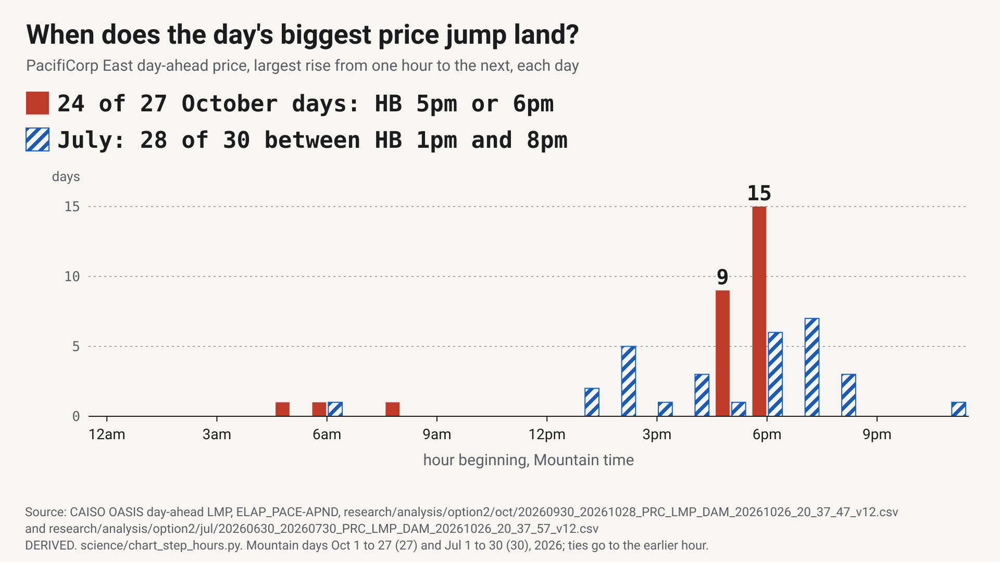
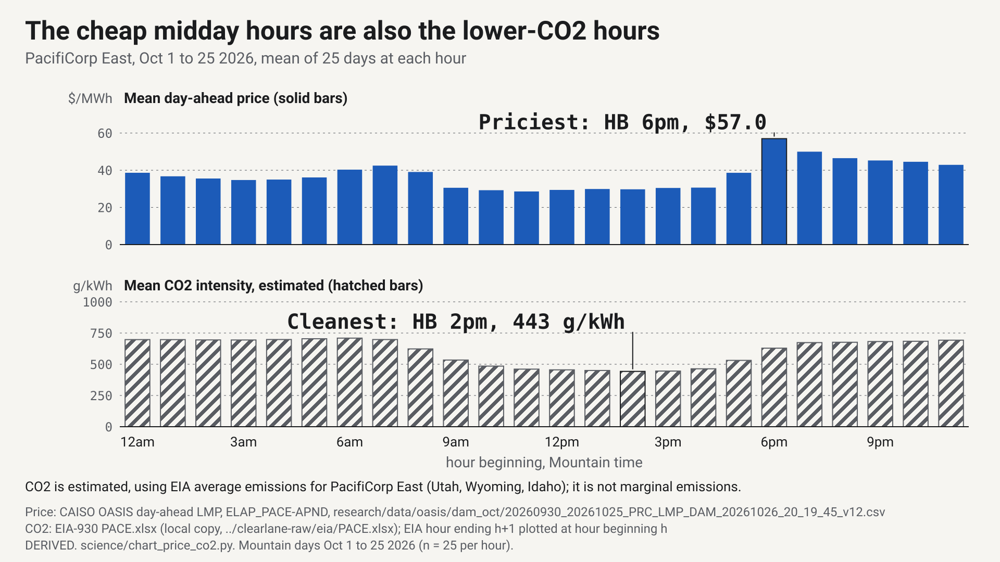

# Why Utah's rush hour moved to 6pm

Clearlane science brief, Oct 27 2026. Stations are simulated Torus-style stations. Dollar values are value to RMP's system at day-ahead prices.

**Finding.** In October 2026 the PacifiCorp East day-ahead price jumps at the same hour almost every day, 5pm or 6pm Mountain time, because that is when solar output falls away while demand stays up. In July the jump wandered across the afternoon and evening.

## 1. The price jump now lands at 5pm to 6pm

For each Mountain day we found the hour with the largest rise in the PacifiCorp East (PACE) day-ahead price from the hour before. In October (Oct 1 to 27), that rise landed in the 5pm hour on 9 days and the 6pm hour on 15 days: 24 of 27 days [1]. The median rise was $15.1/MWh [1]. In July (Jul 1 to 30), the same rise was spread out: 28 of 30 days fell somewhere between the 1pm and 8pm hours, no single hour held more than 7 days, and the median rise was $10.1/MWh [1].

"Moved" here means July to October 2026, inside one market regime. PACE day-ahead prices became public when the western Extended Day-Ahead Market (EDAM) went live on May 1 2026 [2], so these files hold one season of prices and support no multi-year price claim [2].

Rocky Mountain Power describes its demand peak as hot summer weekday afternoons, about 3 to 8pm [8]. Utah's residential time-of-use pilot sets on-peak at 6 to 10pm on weekdays [9]. The October price data put the sharpest change at the front edge of that evening window.

## 2. Solar sets the clock

The day-ahead forecasts for Oct 27 show the mechanism. Net load is what other plants must cover: the PACE day-ahead load forecast minus the EDAM solar and wind forecasts. These are forecasts published the day before, not metered values. Net load stood at 604.6 MW in the 3pm hour and 4,259.1 MW in the 6pm hour, a climb of 3,654.5 MW in three hours [3]. Over the same hours the solar forecast fell from 2,189 MW to 987 MW in the 5pm hour and 36 MW in the 6pm hour [4]. We computed the climb twice, from the raw CAISO load and EDAM forecast files and from the repo's snapshot file, and the two agree exactly at all 24 hours [3].

The price followed. It was $21.38/MWh in the 3pm hour and $55.78/MWh in the 6pm hour, the day's low and high [4]. On Clearlane's lane rule, the clear lane that day was any hour at or under $29.98/MWh and the jam was any hour at or over $47.18/MWh [5]. Eight hours, 9am through 4pm, were in the clear lane. The jam began in the 6pm hour and ran through the 11pm hour, 6 hours in all [4, 5].

## 3. The cheap hours are the lower-CO2 hours

Averaged over Oct 1 to 25, the midday hours from 9am through 3pm cost $29.70/MWh and the evening hours from 6pm through 9pm cost $49.68/MWh [6]. Estimated CO2 intensity, using EIA's average emissions for PacifiCorp East (Utah, Wyoming, Idaho), was 468 g/kWh at midday and 665 g/kWh in the evening [6]. The cleanest hour was 2pm, at 443 g/kWh, and the dirtiest was 6am, at 709 g/kWh [6]. Our hourly means match the ledger's October profile to within 0.5 g/kWh at every hour [6].

The fuel mix tells the same story from another side. Ranking the 600 October hours by price, the priciest tenth averaged $67.3/MWh with 85.1% of generation from coal and gas, while the cheapest tenth averaged $23.0/MWh at 39.8% [7].

## 4. What follows for a simulated Torus-style station

A station with a Pulse battery and a Spin flywheel can use this pattern in two ways.

- **Fill in the clear lane.** Charge Pulse in the midday hours, when the price is low and the estimated average emissions are lower, rather than on a fixed overnight rule. The fixed overnight rule is our comparison rule, not Torus practice.
- **Keep Spin ready for the jam.** Spin completes a full discharge in 6 minutes and can discharge and recharge in 12 [10]. The published Rocky Mountain Power event ran about 5.6 minutes, so a call of under six minutes fits inside one Spin discharge [10]. The jam hours are when Pulse is most likely to be discharging into high prices, so Spin, not Pulse, should carry the reserve then.

RMP's 2025 event chart shows calls in every clock hour of the day, at least 1 in each, 359 in all [11]. So Spin stays ready around the clock, and the plan never assumes calls come only in the evening.

## 5. Limits

- **One season.** Public PACE day-ahead prices start May 1 2026, so July versus October is the only comparison this data allows.
- **Forecasts, not metered values.** The Oct 27 net load uses day-ahead forecasts. EIA-930 actuals measure a different quantity and will not match them hour for hour.
- **Average, not marginal, CO2.** The CO2 figures are estimated from EIA's average emissions intensity for generated electricity. They are not marginal emissions and not measured outcomes of any station.
- **PACE is not only Utah.** PacifiCorp East covers parts of Utah, Wyoming and Idaho, so its prices and fuel mix describe all three.
- **The heatmap states no time zone.** Any hour-by-hour use of RMP's 2025 event counts must show both the Mountain and the UTC readings. This brief uses only the counts that hold under either reading.
- **Peak windows.** Sources 8 and 9 come from the repo's research notes. The ledger marks the time-of-use row unchecked.

## Sources

1. FACTS `oct_step_hour_days`, `jul_step_hour_spread`; `science/charts/step_hours_oct_jul.json` (`science/chart_step_hours.py`); CAISO OASIS day-ahead LMP, ELAP_PACE-APND, `research/analysis/option2/oct/20260930_20261028_PRC_LMP_DAM_20261026_20_37_47_v12.csv` and `research/analysis/option2/jul/20260630_20260730_PRC_LMP_DAM_20261026_20_37_57_v12.csv`.
2. FACTS `edam_go_live` (https://www.pacificorp.com/about/newsroom/news-releases/extended-day-ahead-market-live.html) and `pace_dam_history_start` (`research/data/caiso7/20260425_20260524_PRC_LMP_DAM_20261026_20_27_01_v12.csv`).
3. FACTS `net_load_climb_mw`; `science/crosscheck.json` (`science/crosscheck.py`); `research/data/caiso3/` (PACE day-ahead load forecast) and `research/data/caiso4/` (EDAM wind and solar forecast).
4. FACTS `price_min_oct27`, `peak_price`; `research/data/pace_snapshot_2026-10-27.csv` (PACE day-ahead price and EDAM solar forecast, Oct 27 2026).
5. FACTS `lane_clear_max_usd`, `lane_jam_min_usd`; `science/crosscheck.json`.
6. FACTS `co2_profile_he_oct`, `co2_midday_avg`, `co2_evening_avg`, `co2_clean_dirty_hours`; `science/charts/oct_price_co2.json` (`science/chart_price_co2.py`); prices from `research/data/oasis/dam_oct/`; CO2 from EIA's PACE workbook (https://www.eia.gov/electricity/gridmonitor/knownissues/xls/PACE.xlsx, local copy in `../clearlane-raw/eia/`), column "CO2 Emissions Intensity for Generated Electricity".
7. FACTS `fossil_priciest_oct`; `science/crosscheck.json`; `research/data/eia930/PACE_EIA930_BALANCE_2026_Jul_Dec.csv`.
8. `research/GRID.md` section 7, citing https://www.rockymountainpower.net/about/newsroom/news-releases/summer-heat-energy-tips.html (not re-opened for this brief).
9. FACTS `utah_tou_peak` (UNCHECKED); `research/GRID.md` section 7, citing https://utahcleanenergy.org/want-lower-electric-bills-heres-how-a-new-program-can-help/ (not re-opened for this brief).
10. FACTS `torus_spin_discharge_min`, `torus_spin_cycle_min`, `rmp_event_minutes`, `spin_covers_call` (TORUS_PUBLISHED and DERIVED).
11. FACTS `rmp_heatmap_by_hour` (TORUS_PUBLISHED, https://www.datocms-assets.com/93357/1778881001-vpp-events-rmp.jpg).
